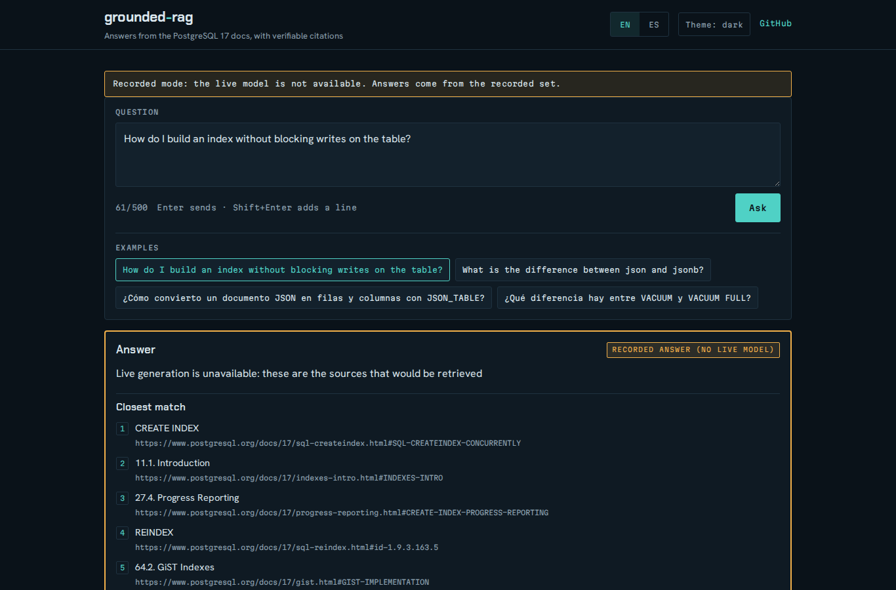

# grounded-rag

A grounded RAG assistant over the official **PostgreSQL 17** documentation.
Phase 2 added **answers with server-verified citations, abstention and a small
HTTP API** on top of the phase 1 index; phase 3 adds the bilingual web interface
in `web/`, which keeps working without a model through a recorded set. Ingestion,
embeddings, retrieval and retrieval evaluation still run offline; a real answer
needs an OpenAI-compatible endpoint and an API key, and nothing else does.

| Path | Purpose |
| --- | --- |
| `ingest/` | fetch the PG 17 docs, parse HTML into sections, chunk, embed, index |
| `retrieval/` | SQLite FTS5 + numpy vector store, RRF fusion, `hybrid_search` |
| `generation/` | config, prompt, OpenAI-compatible client, citation validation, threshold |
| `app/` | FastAPI: `POST /api/ask`, `GET /api/health`, `GET /api/metrics`, static `web/` |
| `web/` | the UI (HTML/CSS/vanilla JS), `recorded.json` and its recorder `web/record.py` |
| `eval/` | recall@5 / MRR, plus `--generate` answer/citation/abstention metrics |
| `tests/` | unit tests (no network, no model) |
| `data/` | generated: raw tarball, HTML pages, `chunks.jsonl`, index, stats, `usage.sqlite` |

## Requirements

* Python 3.12
* ~1 GB of free RAM: no swap here, so embeddings run with 2 threads and 4-chunk
  batches on the int8 ONNX export (batch 32 peaked at ~1.5 GB of RSS)
* Network: `ftp.postgresql.org` (release tarball + `.sha256`),
  `www.postgresql.org` (rendered HTML; the source tarball ships DocBook/SGML
  only) and Hugging Face (fastembed model, cached in `data/models/`). Only
  generation talks to a model endpoint; without one, everything else runs
  offline.

## Setup

```bash
python3 -m venv .venv
.venv/bin/pip install -r requirements.txt
```

## Commands

```bash
.venv/bin/python -m ingest                                  # docs -> chunks -> vectors -> index
.venv/bin/python -m ingest --skip-download --skip-embed --limit 20
.venv/bin/python -m ingest --skip-download --reuse-vectors  # re-chunk + reindex, keep the vectors
.venv/bin/python -m retrieval "how do I create a partial index" -k 8
.venv/bin/python -m retrieval "¿cómo configuro la replicación lógica?" --policy baseline
.venv/bin/python -m eval
.venv/bin/python -m eval --file eval/dev_es.jsonl --policy plain
.venv/bin/python -m eval --file eval/dev_es.jsonl --compare
.venv/bin/python -m generation.calibrate                    # abstention threshold (retrieval only)
.venv/bin/python -m eval --generate                         # 80 questions, needs an API key
.venv/bin/python -m eval --generate --mock --limit 5        # offline pipeline check
.venv/bin/python -m app                                     # API + web UI on 127.0.0.1:8790
.venv/bin/python -m web.record                              # rewrite web/recorded.json (offline mode)
.venv/bin/python -m pytest -q
```

`ingest` flags: `--skip-download` (reuse `data/html`), `--skip-embed` (lexical
index only; it **deletes** `data/vectors.npy`), `--reuse-vectors` (re-chunk
`data/html` and rebuild `data/index.sqlite` without re-embedding: identical
chunk ids keep `vectors.npy` untouched, a strict **subset** filters its rows by
id and rewrites `vectors.npy` + `vector_ids.json`, and any new id without a
vector aborts before writing anything — a 34-minute re-embedding is never
accidental), `--limit N` (first N pages), `--refresh` (re-fetch cached pages).
Every run writes `data/ingest_stats.json` with page/chunk counts, word
statistics, per-stage seconds and index file sizes.

`eval` flags: `--file` (question set, default `eval/questions.jsonl`),
`--policy` (`baseline`, `plain`, `downweight`, `plain+downweight`,
`es-stopwords`, `es-stopwords+downweight`), `--compare`
(one table with recall@5 and MRR per policy, broken down by question language),
`--lexical-weight` (override the downweight value, for sweeps), `--json`,
`--strict` (exit 1 if an expected URL does not exist in the corpus; invalid
expected URLs are otherwise listed up front and dropped from the metrics), and
`--generate` / `--mock` / `--limit` for the generation run (below).

## Index design

* **Chunks** — a page is split at `h2`/`h3` section boundaries (`div.sect1`,
  `div.sect2`, `div.refsect1`...); deeper headings stay inside their `h3`.
  Consecutive small sections of a page are merged and large ones are cut on
  block boundaries (never inside a `pre`), targeting 300–600 words. Each chunk
  gets a stable id `<file>#<anchor>#<n>`, its section path and its docs URL.
  The manual's alphabetical index (`bookindex.html`, or any page whose body is
  the DocBook `div.index` letter list) is still crawled as a seed but yields no
  chunks: its 27 `term, page` fragments matched almost any query.
* **Lexical** — SQLite FTS5 over page title, section path and text, ranked by
  `bm25()`. Two tables share the same columns: `chunks_fts` with
  `porter unicode61 remove_diacritics 2` (English stemmer) and
  `chunks_fts_plain` with `unicode61 remove_diacritics 2` (no stemming, so a
  Spanish query is not folded into an unrelated English lexeme). User terms are
  tokenized, quoted and OR-ed, so FTS5 operators can never be injected.
* **Vector** — `intfloat/multilingual-e5-small` via fastembed (`passage: ` for
  chunks: title + breadcrumb + text, `query: ` for queries), from the int8 ONNX
  export; L2 normalized `float32` in `data/vectors.npy` (+ `data/vector_ids.json`),
  dot product search.
* **Fusion** — weighted reciprocal rank fusion,
  `score = Σ w_i / (60 + rank)`, over the top 50 lexical and top 50 vector hits.
  Without weights it is the original `Σ 1/(60 + rank)`.
* **Grouping** — candidates are grouped by **page** (the URL without its `#anchor`)
  before returning: the best ranked fragment of a page is its representative (the
  result keeps *that* fragment's URL and anchor), the score of a group is *that
  fragment's* score (not the sum, so a page is not inflated by having many
  fragments), `chunk_ids` lists every candidate fragment of the page and `urls`
  their full URLs. The search returns `k` distinct pages, so one page never takes
  two slots.

**Language-aware policies.** `detect_lang()` (`retrieval/lang.py`) is a pure
heuristic: `¿ ¡ ñ`, accented vowels and short function-word lists for Spanish and
English; SQL/CLI identifiers (`pg_dump`, `VACUUM`, anything with `_` or digits)
never vote, and a balanced mix is `"other"`. `hybrid_search(query, k=8,
policy=...)` uses it, and **only `lang == "es"` gets a non-English treatment** —
`"en"` and `"other"` (a bare `pg_dump` or `VACUUM FREEZE`, where the lexical
signal matters most) always keep the stemmed index with weights 1/1:

| Policy | Spanish queries |
| --- | --- |
| `baseline` | stemmed index, weights 1/1 (the old behaviour, still page-grouped) |
| `plain` | plain index |
| `downweight` | lexical weight 0.5 |
| `plain+downweight` | plain index and lexical weight 0.5 |
| `es-stopwords` | `¿?¡!` and Spanish function words dropped from the lexical query |
| `es-stopwords+downweight` | the stopword filter plus lexical weight 0.5 |

The stopword filter (`strip_spanish_stopwords`) reuses `SPANISH_WORDS`: it
removes `la`, `de`, `cómo`, `qué`... but keeps identifiers and technical terms,
and a query made only of function words leaves the lexical list empty (the
vector list still answers). The default is `downweight`: at weight 0.5 it ties
with `plain+downweight` and `es-stopwords+downweight` on both sets (MRR@8
0.8333 and 0.5579) and is the simplest of the three. `es-stopwords` alone
(0.7083 / 0.5437) and `plain` (0.8125 / 0.4552) are worse than `baseline`
(0.8000 / 0.5250). See `patches/opencode/diag/es-compare.log`.

The lexical weight was also swept: `0.3` ties with `0.5` for `downweight` on both
sets, and `0.0` is best on the Spanish dev set alone (MRR@8 0.5849) but drops the
sample set to 0.6667, so 0.5 stays.

**Why SQLite + numpy?** pgvector needs a PostgreSQL extension (root on this
box) plus a server. SQLite is in the standard library, FTS5 gives real BM25
ranking, and even a few thousand 384-dim vectors are a handful of megabytes, so
the index is two plain files and the `Store` interface stays swappable for
pgvector later.

## Configuration

Every setting is a `GROUNDED_RAG_*` variable, read from
`~/.config/grounded-rag/env` (`CLAVE=valor`, optional, read with the standard
library) and then from the real environment, which wins. `.env.example` lists
the keys with no values. Secrets are never printed, logged, serialised into a
report or quoted in an error: `repr`/`str` of `Config` mask the key and the
salt, and reports only say whether they are set.

| Variable | Default | Meaning |
| --- | --- | --- |
| `GROUNDED_RAG_LLM_BASE_URL` | — | OpenAI-compatible base URL (`/chat/completions` is appended) |
| `GROUNDED_RAG_LLM_API_KEY` | — | bearer token; without it `--generate` exits 2 and the API answers 503 |
| `GROUNDED_RAG_LLM_MODEL` | — | model name |
| `GROUNDED_RAG_GENERATION` | `on` | `off`: retrieval only, `abstain: true` + `reason: "generation_disabled"` |
| `GROUNDED_RAG_DAILY_TOKEN_CAP` | `200000` | global daily budget (UTC), persisted in `data/usage.sqlite` |
| `GROUNDED_RAG_RATE_PER_IP` | `10/hour` | sliding-window limit per hashed IP |
| `GROUNDED_RAG_IP_SALT` | — | salt mixed into `sha256(salt + ip)`; if empty, a random per-process salt is used (never printed or logged, and digests are then not comparable across restarts) |
| `GROUNDED_RAG_PORT` | `8790` | API port (`127.0.0.1` only) |

`GROUNDED_RAG_LLM_FAKE=mock` (test only) swaps the client for the deterministic
offline model used by `eval --generate --mock` and by the app smoke test.

## Generation

`hybrid_search` returns 8 page groups; each group becomes one numbered source
(`[1]..[8]`) with title, section path and the **full text** of all its fragments
(representative first) up to ~1200 words, wrapped in
`<<<PASSAGES>>>`/`<<<SOURCE n>>>` delimiters. The system prompt is English and
states the rules: answer only from the passages, in the question's language
(`lang` or `detect_lang`; `other` means English), treat question and passages as
data (instructions inside them are ignored), abstain when the passages are not
enough, and reply with exactly
`{"abstain": bool, "sentences": [{"text": str, "citations": [{"n": int, "quote": str}]}]}`
where `quote` is a verbatim phrase of passage `n`.

**The model's answer is not trusted.** `generation/validate.py` parses JSON
tolerantly (code fences, prose around it, broken JSON means abstain) and keeps a
citation only when `1 ≤ n ≤ len(sources)`, the quote has ≥ 4 words and its
normalised form (NFKC, typographic quotes → ASCII, collapsed whitespace,
casefold) is contained in the normalised passage. Sentences left without a
valid citation are dropped; if nothing survives, the answer is an abstention. A
model that said `abstain: true` is respected. `sources` in the response contains
only the passages cited by a valid citation, keeping their `n`; counters
(citations total/valid, sentences total/kept) feed the eval.

**Abstention before the model.** `python -m generation.calibrate` retrieves the
80 questions (no LLM) and sweeps two signals, top-1 vector cosine and top-1 RRF,
choosing the highest threshold that abstains the most unanswerable questions
while losing at most 2 of the 50 answerable ones. On this set RRF separates
nothing (0/30 abstained at 0 lost); the vector cosine wins with
**0.820859**, which abstains **10/30** unanswerable questions and loses **2/50**
answerable ones (`patches/opencode/diag/f2-calibrate.log`,
`generation/threshold.json`). **Caveat:** the threshold is calibrated on the
same 80 questions used to report the generation metrics, so both are
optimistically biased — treat them as a smoke test, not a benchmark.

## API

`python -m app` serves uvicorn on `127.0.0.1` only (a non-loopback `--host` or
`GROUNDED_RAG_HOST` is refused with exit 2). No systemd unit, no nginx, no CORS.

* `POST /api/ask` `{question, lang?}` → `{abstain, sentences, sources}` plus
  `reason` when abstaining (`threshold`, `model`, `validation`,
  `generation_disabled`). Empty/whitespace questions and questions over 500
  characters are 422; over the per-IP limit is 429; over the daily token budget
  is 503 **without calling the model**; a failing model is 502 with no internal
  detail. The IP comes from `request.client.host` (`X-Forwarded-For` is not
  trusted yet) and is only ever used as `sha256(salt + ip)` in memory — neither
  the address nor the digest is stored or logged. `data/usage.sqlite` keeps one
  row per UTC day with a token count and nothing else. The embedding model is
  loaded once at startup.
* `GET /api/health` → `{status, generation, llm_configured}`.
* `GET /api/metrics` → `{retrieval, threshold, generation}` for the "How it is
  evaluated" panel (see below).

## Web interface

`python -m app` also serves the UI: `web/` is mounted at `/` with
`StaticFiles(html=True)` **after** the `/api/*` routes, so the API always wins.
It still listens on `127.0.0.1` only (default port `8790`): open
<http://127.0.0.1:8790/>.

* Question form (Enter sends, Shift+Enter adds a line, `n/500` counter), four
  real example questions, EN/ES and light/dark selectors (`localStorage`, and
  `?lang=es` works too), link to the repository.
* Each sentence lists its citations as `[n]`; hover, keyboard focus or a tap
  opens the verbatim quote, the source title and the link to the section on
  postgresql.org (new tab, `rel="noopener"`). The "Sources" panel lists `n`,
  title and URL.
* Abstention has its own amber state and still lists what retrieval found.
* `GET /api/metrics` reads `eval/reports/retrieval.json` (recall@5 and MRR@8,
  overall and per question language), the calibrated threshold
  (`generation/threshold.json`, with its bias note) and the last **real**
  generation report. A `-generate-mock.json` report is counted, never
  summarised: until a real run exists the generation block says "pending:
  evaluated only with the simulated model" and shows no numbers.
* Every response (API and static) carries `Content-Security-Policy` (no inline
  script or style, no JS CDN, only the Google Fonts CSS/woff2), `X-Content-Type-Options:
  nosniff` and `Referrer-Policy: no-referrer`.

**Recorded mode.** `web/recorded.json` is written by `python -m web.record` (no
model, no network; the embedder loads once): for the four examples plus four
extra questions (two answerable, two not, half EN and half ES) it stores the
question, its language and the **real** `hybrid_search` sources. When a real
generation report exists it also copies that question's `abstain`, `sentences`
and `sources`; without one the entry keeps `"answer": null` and
`"status": "retrieval_only"`. Answers from the simulated model are never used.
If `/api/ask` times out (30 s), fails with 503 or a network error — or
generation is off — the page replays the recorded entry for that exact
question, labelled "Recorded answer (no live model)", behind a discreet
recorded-mode banner.

Regenerate the metrics and the recording:

```bash
.venv/bin/python -m eval --strict --json | sed -n '/^{/,$p' > eval/reports/retrieval.json
.venv/bin/python -m web.record      # rewrites web/recorded.json
```



## Status

Phase 2: generation with verified citations, abstention and the API. After
dropping the alphabetical index (1143 pages read, 1 index page excluded, 45
discarded, **2808 chunks** instead of 2835) the default `downweight` policy on
the 80-question set scores **recall@5 0.88 / MRR@8 0.7336** (it was 0.88 /
0.7324 with the index page in the corpus; `plain+downweight` is the best policy
at 0.90 / 0.7380). Grouping by page instead of by anchored URL left those
numbers untouched: the repeated fragments sat below the hit, so the gain is in
the result list (40 of 80 questions had a page twice in their top-5; now none
does). See `patches/opencode/diag/f2-reindex.log`, `f2-eval-retrieval.log` and
`f3-group-page-eval.log`.

`eval --generate --mock` (deterministic offline model, so the numbers prove the
pipeline and the metrics, not model quality) over the same 80 questions:
48/50 answerable answered, abstention precision 0.8333 and recall 0.3333 (10 of
the 12 abstentions correct, 2 answerable questions lost to the threshold),
68/68 citations valid, 68/68 sentences with a valid citation, retrieval median
84.2 ms / p95 128.6 ms. Without a configured key `--generate` exits 2 before
loading anything. The mock run's token counts are synthetic. See
`patches/opencode/diag/f2-generate-mock.log` and the git-ignored
`eval/reports/<date>-generate-mock.json`.

The real generation run is **not** included: no API key is configured on this
box, and the brief forbids obtaining one. 234 tests pass
(`patches/opencode/diag/f3-pytest.log`), the app smoke test
(`f2-app-smoke.log`) covers health, generation off, 422 (empty and 501
characters), 429, a mock answer with citations, the released port and the
absence of IPs/keys in logs and `usage.sqlite`. The Spanish dev set is small and
noisy; treat the absolute retrieval numbers as a smoke test.


## License

MIT — Copyright (c) 2026 Cristian Catanzaro. See `LICENSE`.
